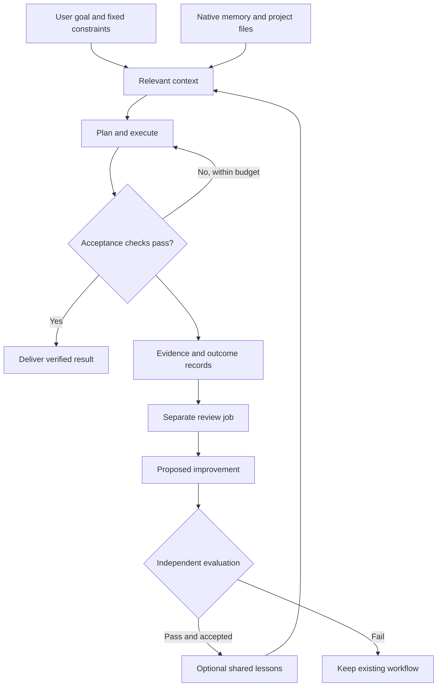

<div align="center">

# Universal Workflow

**Give the goal. Keep the context. Verify the result. Improve the next run.**

A reusable agent skill and Claude Code plugin for games, websites, software, research, documents, and operations.

[](https://github.com/StreetJammer/universal-workflow/actions/workflows/ci.yml)
[](https://www.python.org/)
[](LICENSE)
[](#requirements)
[](#claude-code-plugin)
[](#codex-and-claude-code-skills)
[](docs/VALIDATION.md)
[](https://github.com/StreetJammer/universal-workflow)

[Quick start](#quick-start) · [Architecture](#how-it-works) · [Memory](#use-native-memory-first) · [Automation](#background-review) · [Testing](#testing) · [Contributing](CONTRIBUTING.md)

</div>

## What it does

Universal Workflow coordinates an agent's work from a short request to a verified deliverable. It assembles relevant context, selects specialist workflows, preserves your constraints, checks the result, and keeps useful lessons for later.

- **Automatic task prompting:** preserve the original request and build a working prompt from relevant project context.
- **Domain-aware verification:** use browser checks for websites, engine/play checks for games, and source/render checks for research and documents.
- **Native memory first:** use the host's everyday memory; add shared project memory only when needed.
- **Optional portable memory:** project isolation, provenance, expiry, atomic updates, revision history, rollback, and Markdown/JSON export.
- **Cross-session review:** a separate “dreaming” worker proposes improvements from recorded outcomes.
- **Selected session evidence:** import sanitized messages, tool summaries, skills used, and corrections with bounded, atomic `trace-import` batches.
- **Evaluation before adoption:** workflow changes need a passing, independently executed evaluator before promotion.
- **Host adapters:** install as a Codex or Claude Code skill, load as a Claude Code plugin, or export for another compatible host.

This is a **preview implementation**. It provides a workflow and local tooling; it does not guarantee that any model can finish any task. Native engine/browser access, independent evaluators, authenticated CLIs, and external scheduling remain environment-specific.

## Requirements

| Component | Requirement |
| --- | --- |
| Skill instructions | A host that can load a `SKILL.md` or equivalent instructions |
| Local runtime/installers | Python 3.10+; standard library only |
| Claude plugin | Claude Code with plugin/hook support and `python3` on PATH |
| Codex adapter | Codex with `.agents/skills` support |
| External review worker | An authenticated `claude` or `codex` CLI |
| Workflow evaluation | Your own trusted task-specific evaluator and held-out cases |

No API key is needed for installation, memory operations, or prompt assembly. Live review uses your existing CLI authentication and may consume its normal quota or paid usage.

## Quick start

Clone the repository, then choose one integration:

```bash
git clone https://github.com/StreetJammer/universal-workflow.git
cd universal-workflow
```

### Codex and Claude Code skills

Install for an existing project:

```bash
python3 skills/universal-workflow/scripts/install.py \
  --target both \
  --project /absolute/path/to/your-project \
  --wire
```

The installer copies the skill into `.agents/skills/` and `.claude/skills/`. `--wire` adds a small managed instruction block while preserving existing instructions. Omit it for manual-only discovery. Use `--target codex` or `--target claude` for one tool.

Then invoke:

```text
Codex:       $universal-workflow Add mobile controls while preserving keyboard controls.
Claude Code: /universal-workflow Build and verify the buyer dashboard.
```

For a user-wide install, replace `--project ... --wire` with `--user`. Global instruction files are not modified. Existing destinations must match the complete payload: missing or changed files, extra entries (including Python caches), internal symlinks, and Windows reparse points are rejected. Nothing is automatically removed; use a new directory or explicitly reconcile the old copy before reinstalling.

### Claude Code plugin

The repository itself is a ready-to-load plugin:

```bash
claude --plugin-dir /absolute/path/to/universal-workflow
```

Commands:

```text
/universal-workflow:workflow Complete this task using relevant context and verification.
/universal-workflow:dream Review this project's recorded outcomes and propose improvements.
```

The plugin includes lightweight session, prompt, failure, and stop hooks. They never replace your prompt, call another model, or force a Stop loop. Hooks are inactive until you explicitly initialize project memory. Do not install both the plugin and the standalone Claude skill in the same project unless you want duplicate discovery.

This local loading command does not publish to a marketplace or register a permanent global plugin. See [host adapters](skills/universal-workflow/references/adapters.md) for exports and deployment details.

### Other hosts

```bash
python3 skills/universal-workflow/scripts/install.py \
  --target generic \
  --output /absolute/new/skill-directory
```

Point the host at the exported `SKILL.md` using its documented mechanism. Hermes and other host-specific plugin registrations have not been implemented or validated; the generic skill and JSON CLI are the portability boundary.

## How it works



The agent makes task-specific decisions. Deterministic scripts handle state, transactions, validation, and process limits. A skill does not train model weights or create a background service by itself.

## Use native memory first

Claude Code and Codex have native memory capabilities. Keep personal preferences and ordinary recall there. Keep required rules in project instructions and authoritative facts in their source files.

Use the optional project store for lessons that must travel between hosts, traceable review records, and versioned workflow improvements. The package does not read or synchronize either host's private memory directory. [Native-memory guidance](skills/universal-workflow/references/native-memory.md).

To initialize an optional store:

```bash
python3 skills/universal-workflow/scripts/uw.py --project /absolute/project init
python3 skills/universal-workflow/scripts/uw.py --project /absolute/project status
```

Set reusable command paths in your shell:

```bash
UW=/absolute/path/to/universal-workflow/skills/universal-workflow/scripts/uw.py
PROJECT=/absolute/path/to/your-project
```

Capture and retrieve a lesson:

```bash
python3 "$UW" --project "$PROJECT" remember \
  --key build-command --body-file verified-lesson.txt \
  --evidence 'build-log:verified' --kind fact --ttl-days 30
python3 "$UW" --project "$PROJECT" recall --query "build command"
```

Updates require the exact current hash. `history`, `rollback`, and `expire` preserve the audit trail. `export` writes readable Markdown and a JSON snapshot; `backup` creates a consistent SQLite copy. See [memory operations](skills/universal-workflow/references/memory.md).

## Automatic prompting

```bash
python3 "$UW" --project "$PROJECT" prompt \
  --task-file task.txt --domain game --out working-prompt.md
```

This command performs deterministic context assembly. Your host model creates the detailed plan and executes it. It preserves the original request, retrieves relevant active project lessons, and keeps your goals and permissions fixed.

## Background review

Record compact outcome summaries with `record --file outcome.json`. Use [the example event](examples/outcome.json) and real evidence from your project.

Run one review using your selected CLI:

```bash
python3 "$UW" --project "$PROJECT" dream-run --engine claude
# Or:
python3 "$UW" --project "$PROJECT" dream-run --engine codex
```

Defaults: five new events, up to 50 events per batch, one host CLI invocation, and a 180-second timeout. The worker writes **proposals only**. It does not rewrite project rules or automatically adopt its own suggestions.

For your current host model instead of another CLI, use `prepare`, read the packet, generate a structured response, and `submit` it. `proposals` lists pending changes.

### Evaluate and adopt

Configure a trusted evaluator command in project config. The runtime executes it on both baseline and candidate using the same held-out cases:

```bash
python3 "$UW" --project "$PROJECT" evaluate \
  --id PROPOSAL_ID --cases /absolute/heldout-cases.json
python3 "$UW" --project "$PROJECT" decide --id PROPOSAL_ID --accept
```

Workflow proposals need a strict improvement with no case regressions and all fixed constraints preserved. The evaluator must measure real task behavior; a fabricated score defeats the purpose. See [the evaluator contract](skills/universal-workflow/references/review.md).

To run reviews unattended, connect the one-shot command to a persistent scheduler or CI runner. **No scheduler is installed automatically.** See [automation setup](docs/AUTOMATION.md).

## Testing

```bash
python3 scripts/validate_package.py
python3 -m unittest discover -s skills/universal-workflow/scripts -p 'test_*.py' -v
```

The suite exercises memory history, conflicts, project isolation, expiry, proposal validation, evaluation gates, subprocess failures, hook behavior, and installer preservation. CLI transport tests use fake executables and do not call paid models. [Validation evidence and remaining gaps](docs/VALIDATION.md).

CI runs on Linux, macOS, and Windows. Check the pull request's latest six matrix jobs for the proposed revision; the default-branch badge does not establish that an unmerged branch passes.

## Boundaries

- This local store is not an authenticated multi-tenant memory service. Use OS/service isolation for untrusted users.
- Owner policy and permissions remain outside writable memory. Actor labels are audit labels, not authenticated identities.
- Recall uses lexical matching; it is not a vector index or fleet-scale retrieval system.
- The package never guarantees correctness, production readiness, or improvements across every task.
- Native host integration, model output quality, game-engine execution, and browser interaction require verification in the destination environment.
- No deployments, messages, purchases, or account changes happen merely because you install the skill.

## Documentation

| Topic | Guide |
| --- | --- |
| Core workflow | [SKILL.md](skills/universal-workflow/SKILL.md) |
| Games, websites, and other domains | [Domain profiles](skills/universal-workflow/references/domains.md) |
| Prompt generation and optimization | [Prompting](skills/universal-workflow/references/prompting.md) |
| Native memory coexistence | [Native memory](skills/universal-workflow/references/native-memory.md) |
| Transactional project memory | [Memory runtime](skills/universal-workflow/references/memory.md) |
| Review and evaluation | [Review workflow](skills/universal-workflow/references/review.md) |
| Selected session imports | [Session traces](docs/SESSION_TRACES.md) |
| Host integration | [Adapters](skills/universal-workflow/references/adapters.md) |
| Source concepts | [Source map](skills/universal-workflow/references/source-map.md) |
| Coverage against the entire speech | [Speech audit and missing capabilities](docs/SPEECH_AUDIT.md) |
| Release gaps | [Gap analysis](docs/GAP_ANALYSIS.md) |

## Contributing and attribution

Bug reports and focused pull requests are welcome. Include the triggering input, expected behavior, actual result, and a regression test when useful. See [CONTRIBUTING.md](CONTRIBUTING.md) and [SECURITY.md](SECURITY.md).

Inspired by the context-engineering and memory-consolidation ideas in a supplied AI DevCon talk. The original transcript is not redistributed. This is an independent implementation and is not affiliated with or endorsed by Anthropic or OpenAI.

[MIT License](LICENSE) · Copyright © 2026 Arun Christudhas.
